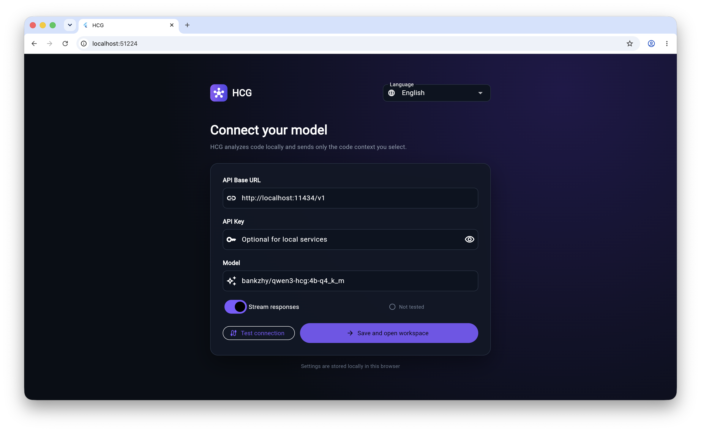
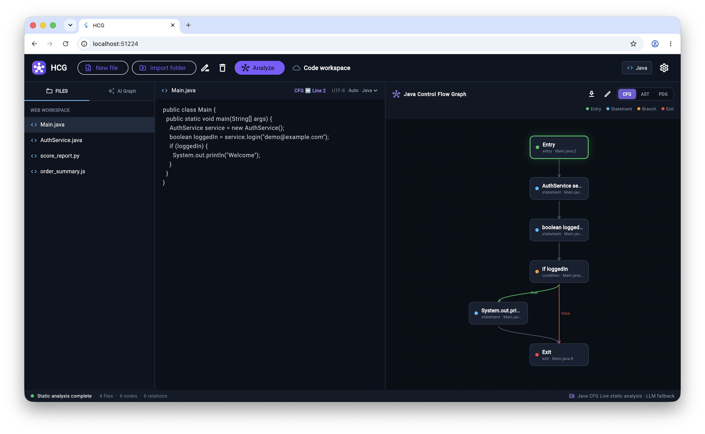

# HCG Web

HCG (Hybrid Code Graph) is a browser-based code analysis tool that combines lightweight static analysis with large language models. It generates and visualizes CFG, AST, and PDG graphs, and provides code repair, code-graph queries, highlighted code-to-graph mapping, manual graph editing, and AI-assisted graph modification.

## Demo

-  [Watch the HCG demonstration video](https://youtu.be/Oi5JmsrKvLU)
- [Open the online version](https://bankzhy.github.io/hcg/)

## Related Paper

> Hanyu Zhang and Tomoji Kishi. [*Finetuning Lightweight LLMs for Control Flow Graph Generation*](https://arxiv.org/abs/2607.04582). The 38th International Conference on Software Engineering & Knowledge Engineering (SEKE 2026), Short Paper. DOI: [10.18293/SEKE2026-036](https://doi.org/10.18293/SEKE2026-036).


### Using a local LLM with Ollama

When you want to use a local LLM, install and run [Ollama](https://ollama.com/) on your computer.
You Must download the HCG repository and connect it to Ollama.

1. Install and start Ollama.
2. Download a model, for example:

   ```bash
   ollama pull qwen3:4b
   ```

3. Open the index.html of HCG project.
4. On the HCG **Settings** page, enter:

   - API base URL: `http://localhost:11434/v1`
   - Model: the Ollama model name you downloaded
   - API key: leave empty unless your Ollama setup requires one
Reason:
Browser security settings may prevent a public HTTPS page from connecting to a service on `localhost`.

### Remote use: enter an API directly

When using a remote LLM service, local Ollama is not required.
Open the [online HCG application](https://bankzhy.github.io/hcg/) and enter the following information on the **Settings** page:

- An OpenAI-compatible API base URL
- The model name
- The API key, if required

The remote service must allow browser requests through CORS and should provide an HTTPS endpoint. Settings are stored only in the current browser's local storage. Do not save a private API key on a public or untrusted computer.

## Screenshots







## Browser Support

- Recommended: the latest Chrome or Edge
- Firefox and Safari: the basic interface may work, but Web App installation and local-model access can be more restricted
